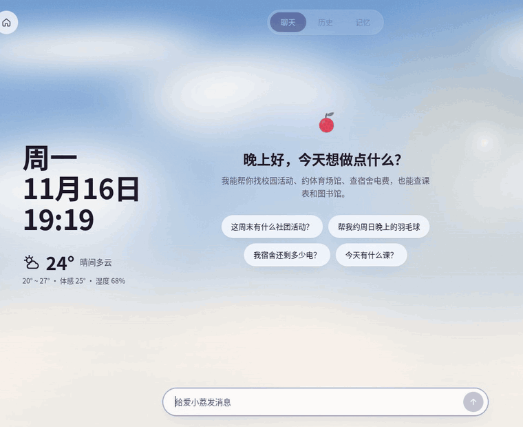

# 爱小荔 · 深大荔园助手

用对话办理深圳大学的日常事务：预约场馆与琴房、检索公文通、图书预借、查询校历和奖学金细则。

基于 LangGraph 智能体 + MCP 工具服务，自行实现统一身份认证与各业务系统的接口适配，不依赖浏览器自动化。

<p align="center"></p>

<p align="center"><sub>演示模式录屏（样例数据）：一句话发起预约 → 确认卡片 → 付款卡片</sub></p>

## 功能

| 模块 | 说明 |
|---|---|
| 体育场馆 | 查询空场、预约（26 个项目，包场 / 散场）、取消；生成付款卡片，由用户在学校页面完成支付 |
| 公共空间 | 事务中心的琴房、会议室、心灵小屋：查询空闲时段、预约、取消 |
| 公文通 | 检索通知、阅读正文、提炼要点（截止时间、申请条件）、下载附件 |
| 图书馆 | 馆藏检索、在架状态、预借到取书点、取消预借 |
| 校园资料 | 校历与教学周、上课作息、奖学金评选细则、活动场地 |
| 宿舍电费 | 余额与用电记录查询、生成充值入口（需校园网环境） |
| 记忆与历史 | 记住宿舍、学院、常用校区等偏好；对话历史保留 30 天 |

**安全设计**

- 密码与验证码仅经后端接口提交至学校统一认证，全程不进入大模型上下文，也不落盘。
- 预约、取消等写操作须由用户在确认卡片上点击确认，令牌一次有效。
- 支付环节由用户本人在学校官方页面完成。
- 多用户部署时，每位用户的登录状态、记忆、对话历史与用量记录相互隔离。

## 本地部署

环境要求：Python 3.12+、[uv](https://docs.astral.sh/uv/)、任一兼容 OpenAI 接口且支持函数调用的大模型（默认 DeepSeek）。

```bash
uv sync
cp .env.example .env            # 填写 LLM_API_KEY
uv run szu-agent-web --mock     # 演示模式：样例数据，无需深大账号
uv run szu-agent-web            # 真实模式
```

浏览器打开 http://127.0.0.1:8000 即可使用。首次调用需要登录的功能时，对话中会出现登录卡片（企业微信扫码或账号密码），登录完成后自动继续当前任务。

宿舍电费等内网功能需在校园网环境下使用；校外可先连接学校 SecureLink 零信任。

## 服务器部署

多用户模式：每位用户通过深大统一身份认证登录，数据按用户隔离。

```bash
# 本机打包上传后，在服务器上执行（Ubuntu 22.04 / 24.04）
bash setup-server.sh <服务器公网IP> [域名]   # 提供域名时自动申请 Let's Encrypt 证书
```

一键脚本完成服务安装、HTTPS 与接口限流配置。详细步骤、配置项与注意事项见 [部署说明](docs/deploy-multiuser.md)。

## 文档

- [设计说明](docs/design.md)：架构、功能验证状态、工程取舍
- [新增工具](docs/adding-a-tool.md)
- 接入其他 MCP 客户端（Claude Desktop、Cursor 等）：参考 `mcp-config.example.json`
- 测试：`uv run pytest`（无需模型密钥与网络）

## 致谢

- 宿舍电费查询协议参考 [szu-dianchacha](https://github.com/yuyiwei01/szu-dianchacha)（MIT License）
- 健身房预约接口参考 [szu_gym_helper](https://github.com/Georgeupup/szu_gym_helper)

## 免责声明

- 本项目为个人学习与技术研究作品，与深圳大学无隶属关系，亦非学校官方产品。
- 所有访问均经由学校官方统一身份认证，遵守各系统的验证码与访问频率限制；查询请求设有缓存与并发上限。
- 涉及付款的环节均由用户本人在学校官方页面完成，本项目仅提供跳转入口。
- 使用者应遵守学校相关规定，因使用本项目产生的一切后果由使用者自行承担。
